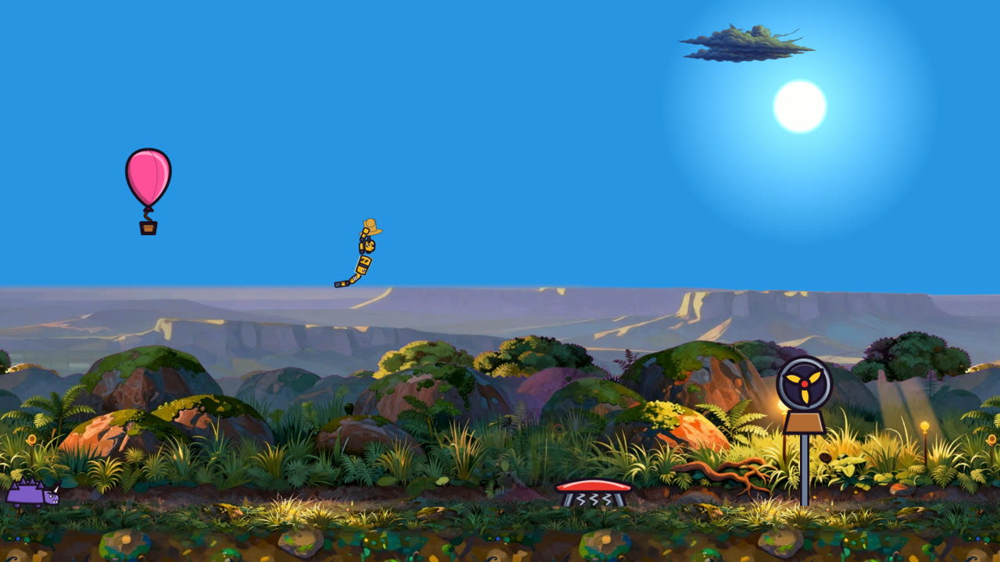

## Sobre mí

Desarrollador generalista. Hoy estoy construyendo un **juego 2D para Android** en Godot, con producción de arte y audio asistida por IA en local. También hago **sitios web** (auditorías, rediseños y prototipos) y herramientas en **Python**.

## Proyectos destacados

<table>
<tr>
<td width="50%" valign="top">

<h3>🐢 Tortugas-mundo (nombre provisional)</h3>
Juego 2D de lanzamiento para Android: mundos planos sobre tortugas gigantes. Godot 4.7, GDScript tipado, más de 900 pruebas automáticas y arte y música producidos con IA local.  
  
</td>
<td width="50%" valign="top">

<h3>🌐 <a href="https://github.com/Drac245/Page">Rediseño web de Mundilácteos</a></h3>
Auditoría del sitio, análisis de competidores y dos conceptos navegables.  
 
</td>
</tr>
<tr>
<td colspan="2">
<h3>🧾 <a href="https://github.com/Drac245/Codigo_limpio">Liquidador de nómina</a></h3>
Cálculo de nómina con horas extras, festivos e incapacidades; interfaz gráfica y de consola, con pruebas. 
</td>
</tr>
</table>

## Herramientas

  

## Actividad

  
  

  

<picture>
  <source media="(prefers-color-scheme: dark)" srcset="https://raw.githubusercontent.com/Drac245/Drac245/output/serpiente-oscura.svg"/>
  
</picture>

